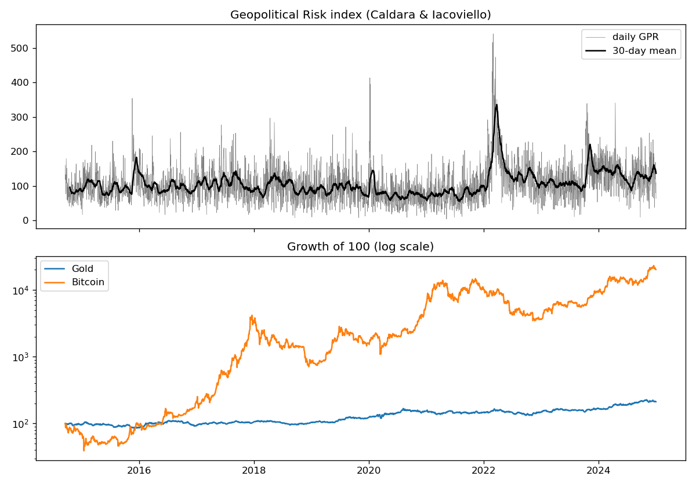

# Is Bitcoin the New Gold? Hedging Geopolitical Risk


An empirical test of whether Bitcoin protects investors against geopolitical shocks the way gold
is supposed to. It started as a group research project for the *FinTech* course (MSc Banking &
Finance, Utrecht University, 2024), building on Aysan et al. (2019), who found that the
Geopolitical Risk index predicts Bitcoin returns and volatility. The original project left
results tables and slides but no code; this repository rebuilds the full study from public data
so that every number can be reproduced with one command.

## Research question and design

Does a rise in geopolitical risk go with **higher returns** (a hedge) or **higher volatility**
for Bitcoin and gold?

$$y_t = \alpha + \beta\,\Delta\ln GPR_t\;[+\;\gamma\,\Delta\ln GPR_{t-1}]\;+\;\delta_1\,\Delta TP_t + \delta_2\,\Delta CS_t + \varepsilon_t$$

| Variable | Definition | Source |
|---|---|---|
| $y_t$ | daily log return (%) or 5-day rolling volatility (%) of Bitcoin and gold | Yahoo Finance (BTC-USD, gold futures GC=F) |
| $GPR_t$ | daily Geopolitical Risk index, counted from newspaper coverage of wars, terrorism and inter-state tensions | Caldara & Iacoviello (2022) |
| $\Delta TP_t$ | change in the 10-year Treasury term premium | FRED `THREEFYTP10` (Kim-Wright) |
| $\Delta CS_t$ | change in the Baa-Treasury credit spread | FRED `BAA10Y` |

Estimation is OLS with **Newey-West standard errors**, because rolling volatility is strongly
autocorrelated and heteroskedastic (see the Breusch-Pagan column in the results). Robustness
checks: one lag of GPR, the proposal's June 2018 to December 2023 window, 2014-2019 and
2019-2024 sub-samples, and only the days with the largest 10% of GPR increases.

## Findings (2014-09-17 to 2024-12-30, 2,587 trading days)

Full tables: [docs/results.md](docs/results.md).

1. **Neither asset reacts to geopolitical news on the same day.** The GPR coefficient is small and
   insignificant for both returns and both volatilities, with or without controls.
2. **Gold reacts with a one-day delay.** With a lag added, gold returns rise about 0.11% the day
   after a 100% jump in the GPR index (p = 0.02), consistent with a slow-moving safe haven.
   Bitcoin shows no such effect.
3. **Bitcoin does not behave like a hedge.** Its GPR coefficient is negative in most
   specifications and weakly significant in 2019-2024 (−0.44, p = 0.08): it tends to fall
   when geopolitical risk rises. On the largest GPR shock days its volatility rises
   (p = 0.06), the opposite of what a safe haven should do.
4. **Macro-financial factors matter much more than GPR.** A rising term premium pushes gold down
   strongly in every sample (higher real yields raise the cost of holding a non-yielding asset).
   Wider credit spreads raise Bitcoin volatility, which looks like a risk asset, not a haven.

**Conclusion:** over 2014-2024 Bitcoin is not "the new gold" as a geopolitical hedge. Gold offers
at best a delayed and modest hedge, and both assets are driven more by interest rates and credit
conditions than by geopolitical headlines.



## Quick start

```bash
git clone https://github.com/Amir-Shokat/bitcoin-gold-geopolitical-risk.git
cd bitcoin-gold-geopolitical-risk
pip install -e ".[dev]"
pytest                                   # runs on synthetic data, no network needed

python scripts/run_study.py              # downloads all data, rewrites docs/results.md
python scripts/run_study.py --end 2026-10-01
```

## Project layout

```
src/geo_hedge/
    data.py     downloads GPR / Yahoo / FRED and aligns everything on gold trading days
    models.py   OLS with HAC errors, Breusch-Pagan test, publication-style tables
scripts/run_study.py
tests/          checks that known effects are recovered and that there is no false positive on synthetic data
```

## Notes on the rebuild

* The original drafts used FactSet prices, which are licensed and not reproducible. This version
  uses only free sources, so coefficients differ in size from the old drafts, but the qualitative
  conclusions (no significant GPR effect for Bitcoin, controls dominate) are the same.
* Bitcoin trades 7 days a week and gold 5. Bitcoin is sampled on gold trading days, so a Monday
  return spans Friday to Monday for both assets. Mixing calendar and trading days would misalign
  the returns.
* The old drafts used plain OLS p-values for volatility regressions, which overstate significance
  for an autocorrelated 5-day rolling measure. HAC errors fix this.

## References

* Aysan, A. F., Demir, E., Gozgor, G., & Lau, C. K. M. (2019). Effects of the geopolitical risks on
  Bitcoin returns and volatility. *Research in International Business and Finance*, 47, 511-518.
* Baur, D. G., & Smales, L. A. (2020). Hedging geopolitical risk with precious metals.
  *Journal of Banking & Finance*, 117, 105823.
* Caldara, D., & Iacoviello, M. (2022). Measuring geopolitical risk. *American Economic Review*,
  112(4), 1194-1225.

## Credits

The research question and the original drafts were a group effort; this code base and the
results above are my own reconstruction.

## License

MIT for the code. The data belongs to its providers (Caldara & Iacoviello, Yahoo Finance,
Federal Reserve Bank of St. Louis) and is downloaded at run time, not redistributed.
